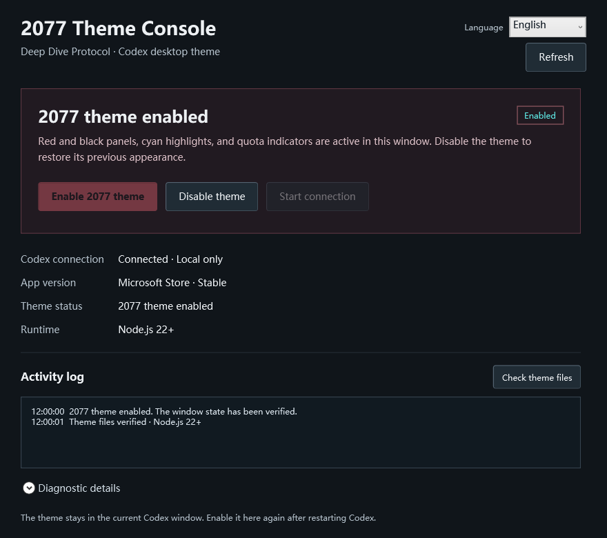

# Codex 2077 Theme Console

English · [中文](README.md)

A Windows WPF control panel for a red-and-black, cyan-accented 2077-inspired Codex / ChatGPT desktop theme. Enable or remove the theme, inspect connection and application status, and switch the launcher between Chinese and English.

This is an unofficial community project.

## Download

Download `Codex2077-v1.0.0-windows-x64.zip` from [Releases](https://github.com/beaver-fpv/codex-2077-theme/releases), extract the entire archive, and open `2077主题控制台.exe`. Keep the adjacent `Theme` directory.

Requires Windows x64, .NET Framework 4.8, and [Node.js](https://nodejs.org/) 22 or later. These dependencies and Codex are not bundled.

1. Open the console and inspect the connection status.
2. If Codex is already running without a debug connection, save your work and exit it yourself, then choose **Start connection**. The console never forcibly terminates Codex.
3. Enable the 2077 theme after connecting. Disable it to restore the target window's previous appearance.
4. Choose **中文** or **English** at the top right. The preference is stored in `settings.json` beside the program. A read-only directory allows a session-only selection.
5. Use the operation log, diagnostics, and theme-file check to investigate errors.

Closing the console leaves the current window's theme active. Reapply after restarting Codex; there is no background reinjection service. To end debugging, exit Codex and reopen it through its normal launcher.

## Preview

Actual WPF renders with demonstration state, containing no personal chat or diagnostics:



## Credits and provenance

This solution references both of the following projects:

- **[zczczzc431/codex-deep-dive-theme](https://github.com/zczczzc431/codex-deep-dive-theme)** is the actual source of the theme and quota component, pinned to commit `4a02de987cdba821e6b6f26ad1a1747c92f7aafa`. This repository modifies those assets for performance and integrates them with the local controller. Its [MIT license](Theme/LICENSE) is retained.
- **[Fei-Away/Codex-Dream-Skin](https://github.com/Fei-Away/Codex-Dream-Skin)** is a design and workflow reference for changing the desktop appearance while retaining native controls and providing graphical management. Its application, installer, and theme library are not bundled. This is not an official fork.

The theme also derives CSS from [HeiGeAi/heige-codex-skin-studio](https://github.com/HeiGeAi/heige-codex-skin-studio). Its MIT notice remains in [THIRD_PARTY_NOTICES](Theme/THIRD_PARTY_NOTICES.md).

The WPF console, bilingual UI, local installation and connection checks, state readback, and packaging are additions in this project. Existing theme code and visual references are not claimed as original work.

## Compatibility and operation

Live application and removal were tested locally on Windows Store version `26.1103.4239.0` using the Owl runtime. Other versions need separate verification, and desktop updates can change selectors or debugging support.

The console injects CSS and a quota helper through a local-only debugging connection at `127.0.0.1:9341`. It checks the listener and owning process, excludes helper and detached windows, and rolls back a failed application or a detected control-position change. It does not patch the installed package, `app.asar`, WindowsApps, model settings, or API configuration. The debugging endpoint can control the page; do not expose or forward it publicly.

Only the latest 50 operation-log entries remain in the current console session. This project does not upload chats.

## Build and verify

Run on Windows with Windows PowerShell or PowerShell 7:

```powershell
./Build.ps1
node ./Theme/scripts/theme.mjs check
node --test ./Theme/tests/*.test.mjs
./VerifyBackend.ps1
./Verify.ps1
./Package.ps1 -Version 1.0.0
```

The build uses the installed .NET Framework compiler without NuGet dependencies. Backend checks use isolated temporary fixtures and need no installed Codex. UI verification renders controls and checks states without enabling or removing a live theme. Release archives are written to `dist`.

See [performance verification](docs/performance.md) for the scope and limitations of the measurements. No cross-device frame-rate improvement is claimed.

## License

New code is licensed under [MIT](LICENSE); third-party notices remain applicable. Cyberpunk 2077, Arasaka, Codex, ChatGPT, and related names and visual references belong to their respective rights holders. The code license grants no trademark or game-artwork rights. This project is not affiliated with their official teams.
