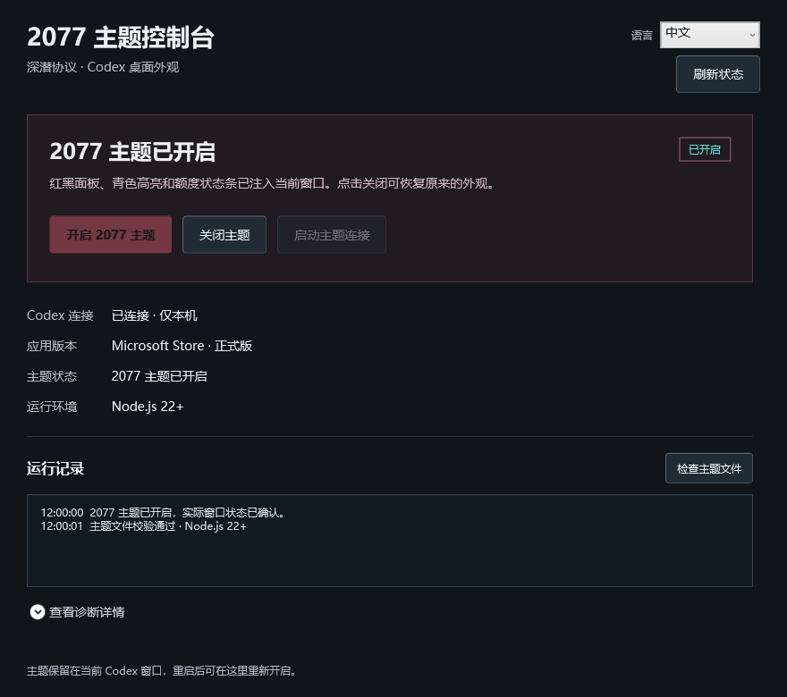
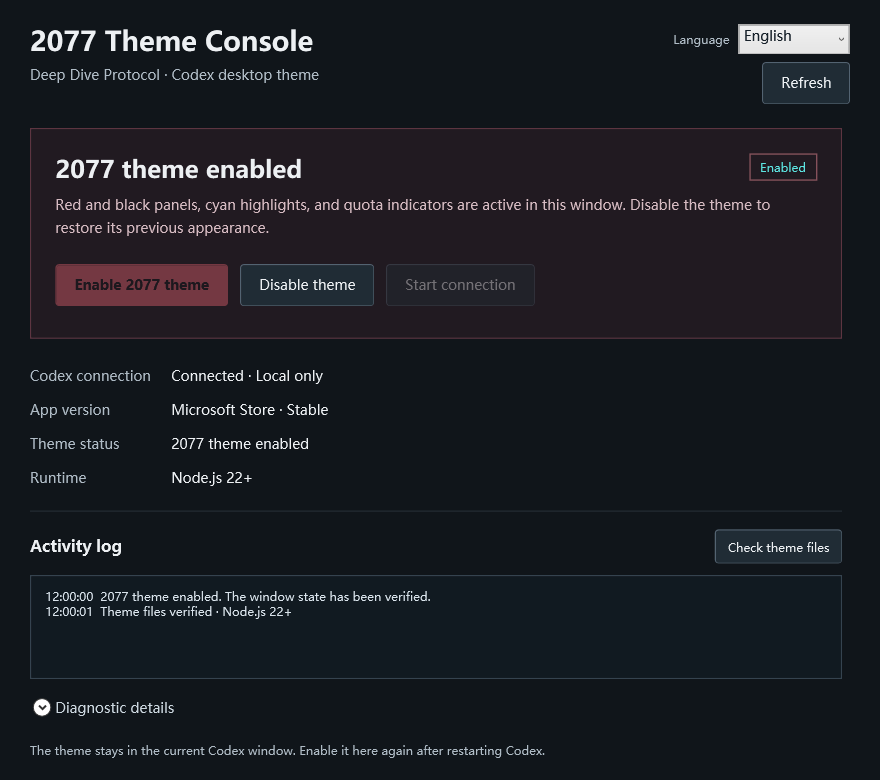

# Codex 2077 Theme Console

[English](README.en.md) · 中文

给 Windows 上的 Codex / ChatGPT 桌面应用换上红黑、青色点缀的 2077 风格，并用独立的图形控制台管理主题。

这是非官方社区项目。控制台是原生 WPF `.exe`，支持 **中文 / English 即时切换**，可以开启、关闭主题，查看连接、版本、状态和操作结果。

## 下载和使用

在 [Releases](https://github.com/beaver-fpv/codex-2077-theme/releases) 下载 `Codex2077-v1.0.0-windows-x64.zip`，完整解压后打开 `2077主题控制台.exe`。请保留旁边的 `Theme` 文件夹。

需要 Windows x64、.NET Framework 4.8，以及 [Node.js](https://nodejs.org/) 22 或更新版本。下载包不包含 Codex、Node.js 或 .NET 安装程序。

1. 打开控制台，查看应用与连接状态。
2. 如果 Codex 正在以普通方式运行，先保存工作并自行退出，再点「启动主题连接」。控制台不会强制结束正在运行的应用。
3. 连接成功后点「开启 2077 主题」。点「关闭主题」可恢复该窗口原来的外观。
4. 右上角选择「中文」或「English」。选择保存在程序旁的 `settings.json`；目录不可写时，仅对本次会话生效。
5. 出现问题时查看「运行记录」和「诊断详情」，或点「检查主题文件」。

关闭控制台后，当前窗口的主题继续保留。Codex 重启后需要重新开启主题；本项目没有常驻后台自动注入服务。结束调试连接时，退出 Codex 后从原来的入口正常启动即可。

## 控制台预览

以下是实际 WPF 界面渲染，使用示例状态，不包含聊天内容或个人诊断数据。

| 中文 | English |
| --- | --- |
|  |  |

## 功能

- 原生图形界面开关，支持中英切换和语言偏好保存。
- 检查应用版本、Node.js、主题资源完整性和连接状态。
- 多个主窗口时明确选择目标；排除宠物、辅助层和独立聊天窗口。
- 红黑背景、荒坂风格水印、红色边角、青色交互反馈，以及侧栏、聊天、输入区和顶部菜单的主题样式。
- 合并额度菜单更新，避免监听整个聊天页面；收窄高开销的样式匹配范围。
- 应用失败或控件发生位置变化时回滚；关闭主题时恢复原有状态。

## 参考与致谢

这套方案参考了以下两个项目：

| 项目 | 本项目采用方式 |
| --- | --- |
| [zczczzc431/codex-deep-dive-theme](https://github.com/zczczzc431/codex-deep-dive-theme) | **实际主题代码来源**。以提交 `4a02de987cdba821e6b6f26ad1a1747c92f7aafa` 的 Deep Dive 主题和额度组件为基础，进行性能优化、样式调整和本地控制集成。保留 [主题 MIT 许可证](Theme/LICENSE)。 |
| [Fei-Away/Codex-Dream-Skin](https://github.com/Fei-Away/Codex-Dream-Skin) | **方案参考**。参考在保留原生控件的前提下更换桌面外观、提供图形化管理的思路；本仓库没有打包其应用程序、安装器或主题库，不是其官方分支。 |

Deep Dive CSS 还包含源自 [HeiGeAi/heige-codex-skin-studio](https://github.com/HeiGeAi/heige-codex-skin-studio) 的代码，相关 MIT 声明见 [THIRD_PARTY_NOTICES](Theme/THIRD_PARTY_NOTICES.md)。

本项目新增了 Windows WPF 控制台、中英切换、应用和连接检查、主题状态回读、测试与发布流程。已有主题代码和视觉参考不宣称为原创。

## 兼容与连接方式

本地已验证的版本是 Windows 商店版 `26.1103.4239.0`，其内部运行时为 Owl。桌面应用更新可能改变页面结构或调试能力；其他版本需要单独验证。

控制台通过 `127.0.0.1:9341` 的本地调试连接向目标主窗口应用 CSS 和额度组件，不修改安装包、`app.asar`、WindowsApps 或模型/API 配置。启动前会检查应用是否正在运行，连接时检查端口是否仅监听本机、所属进程是否为目标安装版本。调试接口具有页面控制能力，请不要将此端口转发到公网。

运行记录只保留控制台本次会话的最近 50 条。语言偏好保存在程序目录；本项目不上传聊天内容。

## 从源码构建

在 Windows PowerShell 或 PowerShell 7 中运行：

```powershell
./Build.ps1
node ./Theme/scripts/theme.mjs check
node --test ./Theme/tests/*.test.mjs
./VerifyBackend.ps1
./Verify.ps1
./Package.ps1 -Version 1.0.0
```

`Build.ps1` 使用 Windows 已安装的 .NET Framework 编译器，不需要额外 NuGet 包。`VerifyBackend.ps1` 用隔离的临时目录测试路径和目标校验，不需要安装 Codex。`Verify.ps1` 渲染界面并检查状态，不执行主题开关。打包结果位于 `dist`。

```text
Panel.cs / Panel.xaml       控制台界面
Localization.cs             中英文本与偏好
Backend.cs                  安装检测、连接验证和主题操作
Theme/                      固定来源版本上的本地主题、脚本和测试
Validation/BackendTests.cs  可移植后端检查
docs/                       示例界面与性能验证边界
```

性能测试范围及限制见 [验证记录](docs/performance.md)。尚未获得可跨设备复现的整体帧率提升结论。

## 许可

新增代码使用 [MIT](LICENSE) 许可。第三方代码继续适用各自保留的许可声明。Cyberpunk 2077、Arasaka、Codex、ChatGPT 等名称及视觉参考归各自权利人所有；代码许可不授予商标或游戏美术权利。本项目不隶属于这些产品的官方团队。
